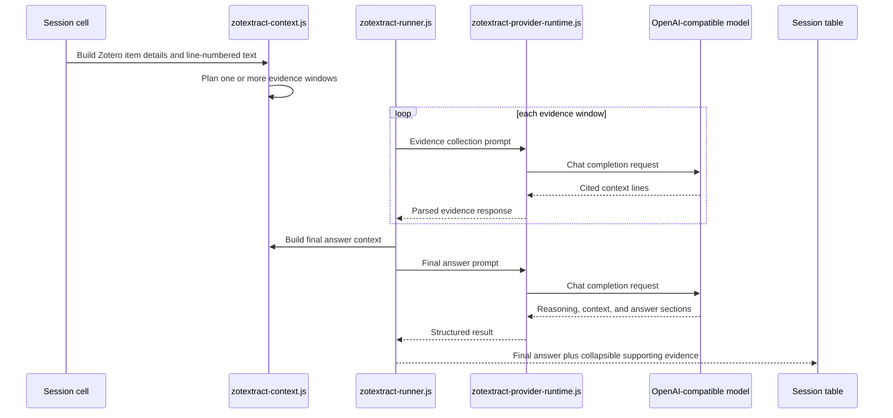

# ZotExtract Prompt And Extraction Architecture

This document explains how ZotExtract builds extraction prompts, sends them to an
OpenAI-compatible provider, and turns model responses into reviewable Zotero session results.

## Runtime Modules

The release bundle contains `manifest.json`, `chrome.manifest`, `bootstrap.js`, `icon.svg`,
`content/`, and `locale/`. Documentation, scripts, tests, and generated artifacts are not bundled
in the `.xpi`.

The extraction path is split across these runtime files:

| Source | Responsibility |
| --- | --- |
| `bootstrap.js` | Zotero lifecycle and script loading. |
| `content/zotextract.js` | Base ZotExtract object, shared defaults, prompt templates, and preference keys. |
| `content/zotextract-data.js` | Question sets, sessions, local JSON storage, and session edit helpers. |
| `content/zotextract-context.js` | Zotero item metadata, PDF text extraction, line numbering, token budgets, and evidence windows. |
| `content/zotextract-runner.js` | Session run planning, extraction cell execution, retries, cancellation, and progress state. |
| `content/zotextract-session-ui.js` | Session list, workspace table, result cells, and context summaries. |
| `content/zotextract-evidence-ui.js` | Result actions, PDF evidence opening, table resizing, and question picker interactions. |
| `content/zotextract-provider-runtime.js` | Provider calls, response parsing, structured result construction, and evidence attachment. |
| `content/zotextract-session-export.js` | XLSX, CSV, TSV, JSON, Markdown, and HTML exports without raw PDF full text. |
| `content/prompt-presets.js` | Built-in extraction question sets. |
| `content/provider-settings.js` | Provider defaults and settings normalization. |
| `content/preferences.{js,xhtml}` | Zotero settings pane. |

## Prompt Layers

ZotExtract combines four prompt layers at runtime:

1. **System prompt**: stored in provider settings and sent as the chat `system` message.
2. **Extraction question**: one row in the session table. Built-in questions come from
   `content/prompt-presets.js`; custom questions are stored with the user's question sets.
3. **Evidence collection template**: asks the model to scan line-numbered paper text and return
   cited lines that may answer the question.
4. **Final answer template**: asks the model to answer from Zotero item details plus cited
   line-numbered context.

Prompt templates use placeholders:

- `{{question}}` for the selected extraction question.
- `{{context}}` for Zotero item details plus line-numbered text or evidence.
- `{{windowIndex}}`, `{{windowCount}}`, and `{{windowRange}}` for evidence-window scans.

## Built-In Question Types

Built-in questions are short and designed for comparing rows across papers.

| Type | Output |
| --- | --- |
| `binary` | `Yes`, `No`, or `Unclear`. |
| `list` | Deduplicated names, one per line, or `None`. |
| `semantic` | Short plain text, or `Not reported`. |

The built-in field packs are Overview & Scope, Methods & Data, Results & Evaluation,
Limitations & Critique, and Reproducibility.

## Two-Pass Extraction Flow

## Context Handling

For each paper/question cell, ZotExtract builds the largest useful local context it can from:

- Zotero title, abstract, DOI, and other item details.
- Zotero indexed PDF text when available.
- Line IDs such as `L000123`.
- A source map that can point cited lines back to PDF reader locations when Zotero provides enough
  location data.

If full text is available, ZotExtract first scans it for relevant cited lines. Small papers can fit
in one scan window. Larger papers are scanned in overlapping windows. If no full text is available,
or provider limits force a fallback, ZotExtract answers from Zotero item details only and records a
warning on the result.

The full-text character cap defaults to 400,000 characters and is configurable in Settings.

## Provider Calls

Provider settings are loaded from Zotero preferences through `content/provider-settings.js`.
The provider runtime sends OpenAI-compatible chat-completion requests and supports local or hosted
endpoints. It also parses:

- the default `## reasoning`, `## context`, and `## answer` sections;
- structured JSON answer shapes kept for compatibility;
- cited line ranges returned by the evidence collection pass.

API keys are stored separately from serialized provider JSON.

## Result Data

Each completed result stores:

- the final answer;
- visible reasoning when returned by the model;
- short cited evidence lines;
- warnings;
- source and context details needed for review;
- validation information for parsed structured responses.

The session table shows the final answer first and keeps supporting evidence collapsed by default.
PDF evidence buttons appear only when a saved PDF location is available.

## Exports

Session exports include completed and reviewable results, paper details, question details, answers,
reasoning, short cited evidence, warnings, and extra parsed fields. They do not include raw PDF
full text.
